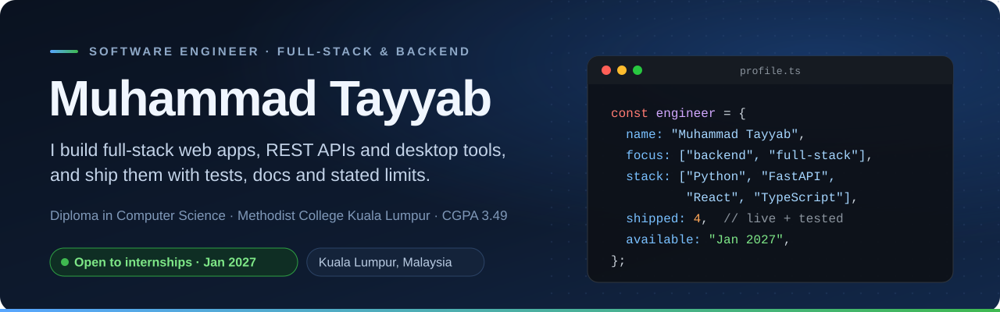
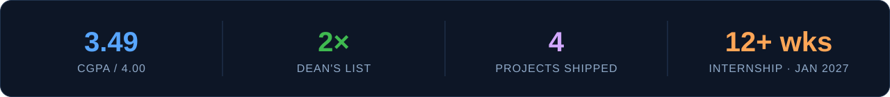
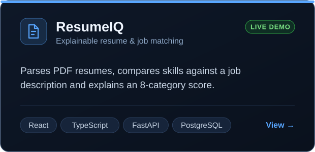
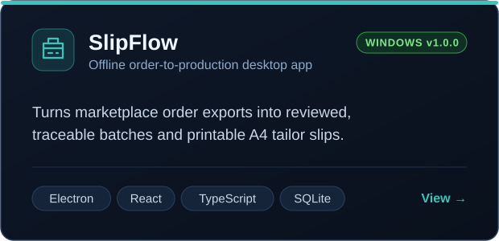
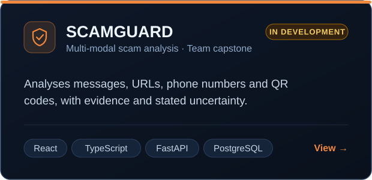
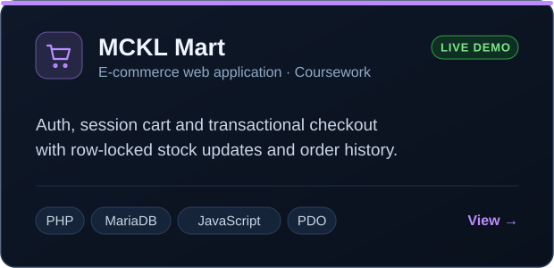
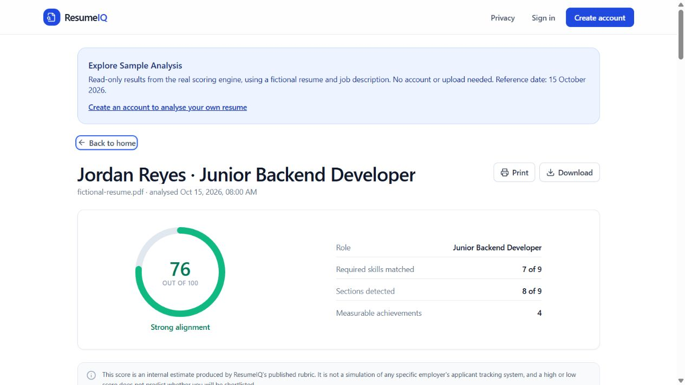
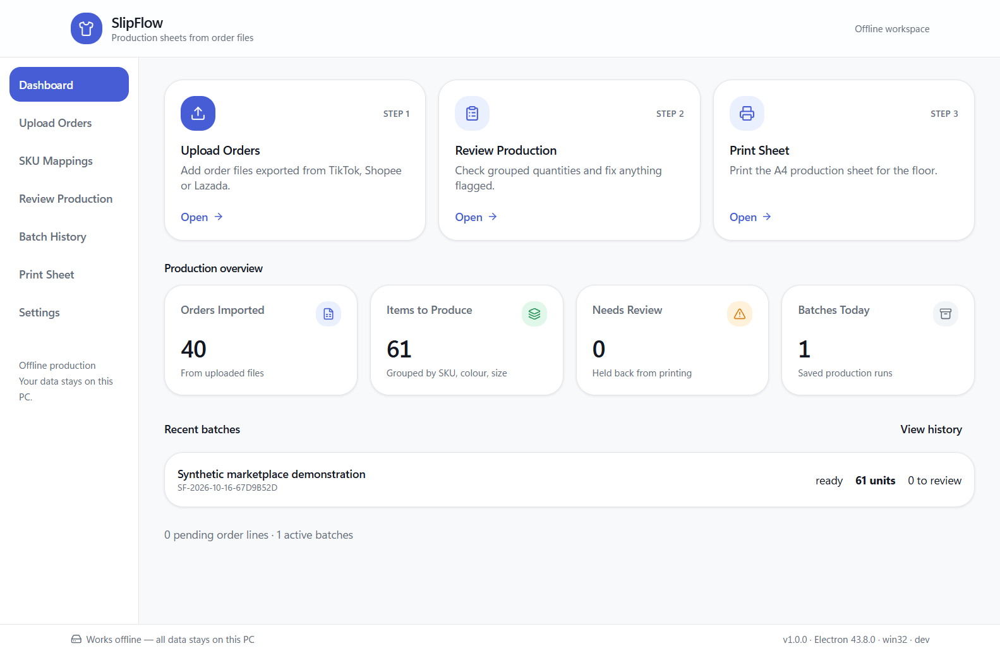

<picture>
  <source media="(max-width: 700px)" srcset="assets/hero-mobile.svg">
  
</picture>

  
  
  
  

## About

I'm a **Computer Science diploma student at Methodist College Kuala Lumpur** and a two-time Dean's List recipient. I build and deploy full-stack software — React front ends, Python/FastAPI and PHP back ends, PostgreSQL and SQLite data layers, and an Electron desktop app used for real manufacturing work.

**What I bring to a team**

- **Backend fundamentals:** REST API design, relational modelling, transactions and migrations, and authentication with sessions, CSRF protection and password hashing.
- **Shipping, not just coding:** every project below is deployed or packaged, and comes with tests, architecture notes and documented limitations.
- **Real-world problem solving:** SlipFlow came out of my operations work in a family manufacturing business, where I saw marketplace orders being consolidated by hand.

I'm looking for a **Software Engineering, Full-Stack or Backend internship from January 2027** (minimum 12 weeks of industrial training).

## Featured projects

  
  

  
  

### ResumeIQ

**Explainable resume analysis and job matching** · Personal full-stack project

Upload a PDF resume and a job description; ResumeIQ extracts the text, matches skills and returns an eight-category score with the evidence and limits behind it.

- Bounded PDF processing, private saved reports, rotating refresh sessions and PostgreSQL integration tests.
- Optional AI suggestions designed never to invent experience or qualifications.

[**Try the sample — no account needed**](https://resumeiq-lemon-eight.vercel.app/sample) · [Live app](https://resumeiq-lemon-eight.vercel.app/) · [Source](https://github.com/tayyab-hub/resumeiq) · [Architecture](https://github.com/tayyab-hub/resumeiq/blob/main/docs/03-architecture.md)

Screenshot

 

Hosted sample with a fictional resume and job description. The score follows the published rubric and does not predict hiring outcomes.

### SlipFlow

**Offline order review and production management** · Independent desktop project · Windows v1.0.0

Turns TikTok Shop, Shopee and Lazada order exports into reviewed production instructions: imports files, maps product variants to factory SKUs, guides operator review and prints A4 tailor slips.

- Source-line traceability, duplicate handling, controlled batch states, SQLite persistence and verified backup and restore.

[**Download the Windows installer**](https://github.com/tayyab-hub/SlipFlow/releases/tag/v1.0.0) · [Source](https://github.com/tayyab-hub/SlipFlow) · [User guide](https://github.com/tayyab-hub/SlipFlow/blob/main/docs/user-guide.md) · [Testing](https://github.com/tayyab-hub/SlipFlow/blob/main/docs/testing.md)

Screenshot

 

Electron app running on synthetic fixtures. Live marketplace formats and physical printers still need field validation.

### SCAMGUARD

**Multi-modal scam analysis platform** · Team capstone, in development

Evaluates suspicious messages, URLs, phone numbers and QR codes, explains the warning signals, states its uncertainty, and keeps each user's analysis history private.

- **My contribution:** frontend and backend workflows for input handling, authentication and session protection, private history and risk explanations, plus automated backend, frontend and browser tests and the Vercel / Render / PostgreSQL deployment.

[**Live prototype**](https://scamguard-my.vercel.app/) (account required) · [Source](https://github.com/tayyab-hub/scamguard-my) · [Architecture](https://github.com/tayyab-hub/scamguard-my/blob/main/docs/ARCHITECTURE.md) · [Limitations](https://github.com/tayyab-hub/scamguard-my/blob/main/docs/LIMITATIONS.md)

### MCKL Mart

**E-commerce web application** · Individual Web Computing coursework

A store flow from browsing to a database-backed order: search and category filters, accounts, a session cart, checkout and order history.

- PDO prepared statements, password hashing, CSRF checks, server-calculated totals and transactional stock updates with row locks.

[**Try the demo store**](https://mcklmart.site.je/) · [Source](https://github.com/tayyab-hub/MCKL-Mart) · [Database design](https://github.com/tayyab-hub/MCKL-Mart/blob/main/database/README.md) · [Testing](https://github.com/tayyab-hub/MCKL-Mart/blob/main/docs/TESTING.md)

Free-tier API hosting for ResumeIQ and SCAMGUARD may take a moment to wake up. Please use fictional data in the demos; MCKL Mart orders and payments are simulated.

## Tech stack

  

| Area | Tools and practices |
| :--- | :--- |
| **Languages** | Python · TypeScript · JavaScript · Java · PHP · SQL |
| **Backend & APIs** | FastAPI · Pydantic · SQLAlchemy · Spring Boot (coursework) · PHP/PDO · REST |
| **Frontend & desktop** | React · Vite · Tailwind CSS · HTML/CSS · Electron |
| **Data** | PostgreSQL · MySQL / MariaDB · SQLite · schema design, transactions, Alembic migrations |
| **Testing** | pytest · Vitest · Playwright · integration tests · JUnit and Android instrumented tests |
| **Delivery** | Git · GitHub Actions · Docker · Vercel · Render · Neon |
| **Security** | Password hashing · prepared statements · session and CSRF protection · CTF practice on Kali Linux |

## Experience

**Technical & E-Commerce Operations Support** · Family-owned manufacturing business · Part-time, 2025

- Investigated account and operational issues on TikTok Shop Seller Center and other seller platforms to keep daily order management running.
- Updated company details and platform settings and troubleshot issues affecting online operations — the groundwork for SlipFlow.

## Education & recognition

**Diploma in Computer Science** · Methodist College Kuala Lumpur (MCKL) · 2025 – present · **CGPA 3.49 / 4.00**

- **Dean's List, twice** — semester GPAs of 3.82 and 3.80.
- Coursework: web development, data structures, object-oriented development (Java, Spring Boot), database systems, cloud computing (AWS), human-computer interaction, data analytics (SAS Viya).
- **MoneyPersona** — Java Android coursework app with XML layouts, SharedPreferences persistence, validation, unit and instrumented tests.

<b>Certificates and events</b>

 

- **AWS Academy Cloud Foundations** — course completion, 2026
- **Google — [Foundations of Data Science](https://www.coursera.org/account/accomplishments/verify/9SXNIF6M0USW)** — Coursera course certificate, 2026
- **Google — [Foundations: Data, Data, Everywhere](https://www.coursera.org/account/accomplishments/verify/29AJI6MDE1O9)** — Coursera course certificate, 2026
- **iCTF 2025** — cybersecurity event participant

<b>Leadership and languages</b>

 

- **Event Coordinator**, MCKL Sport Carnival 2025 — planning, logistics and coordination.
- **Recycling service-learning initiative** — 20 hours on recycling and environmental awareness.
- **Head of Festival Management**, high school — ran festival-day operations.
- **Languages:** English, Urdu and Punjabi (fluent); Bahasa Malaysia (conversational).

## Let's connect

I'm open to **Software Engineering, Full-Stack, Backend or IT Development internships from January 2027**. If you're hiring or want to talk about any of these projects, I'd be glad to hear from you.

  
  

