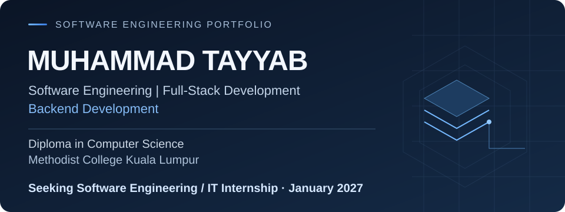
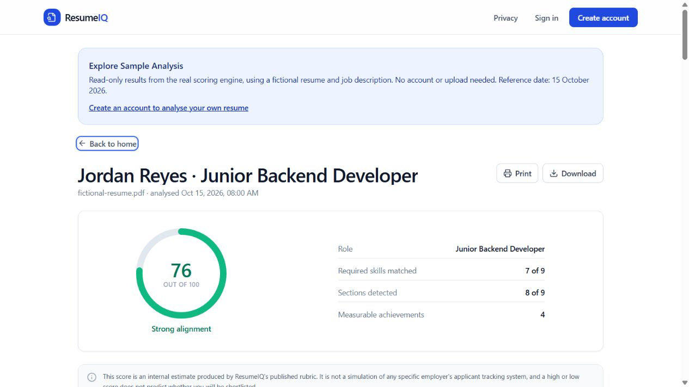
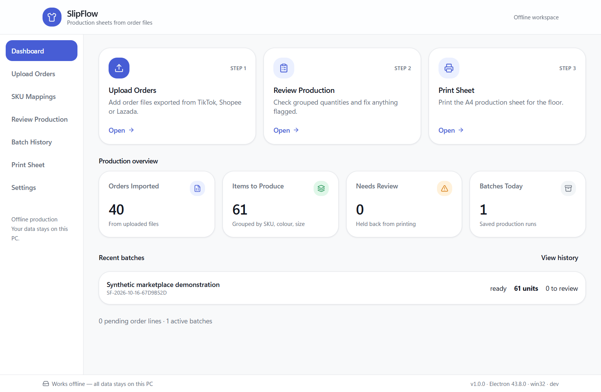

<picture>
  <source media="(max-width: 600px)" srcset="assets/hero-mobile.svg">
  
</picture>

**Available for internships from January 2027** · Kuala Lumpur, Malaysia 
Software Engineering · Full-Stack · Backend · Cybersecurity · IT Development

[Explore projects](#featured-projects) · [Technology stack](#technology-stack) · [Contact me](#connect)

## About me

I'm Muhammad Tayyab, a Diploma in Computer Science student at **Methodist College Kuala Lumpur (MCKL)**. I build practical applications across the frontend, backend and database: explainable resume analysis, offline production workflows, scam-awareness tools and academic e-commerce.

My engineering focus is secure application design, reliable data handling and useful tests. Each project links to implementation details and documented limitations.

## Featured projects

###  ResumeIQ

**Explainable resume analysis and job matching** · Deployed portfolio demo

Comparing a resume with a job description should show the reasoning behind the result. ResumeIQ extracts text from PDFs, compares skills and presents an eight-category score with evidence and limitations.

- **Engineering:** bounded PDF processing, private saved reports, rotating refresh sessions and PostgreSQL integration tests.
- **Stack:** React · TypeScript · Python · FastAPI · PostgreSQL

[Source code](https://github.com/tayyab-hub/resumeiq) · **[Try the sample—no account needed](https://resumeiq-lemon-eight.vercel.app/sample)** · [Live app](https://resumeiq-lemon-eight.vercel.app/) · [Architecture](https://github.com/tayyab-hub/resumeiq/blob/main/docs/03-architecture.md)

View a real application screenshot

Actual hosted sample using a fictional resume and job description. The score follows the project's published rubric; it does not predict hiring outcomes. AI is disabled in the hosted demo.

---

###  SlipFlow

**Offline order review and production management** · Windows release v1.0.0

Turning marketplace exports into sewing instructions requires accurate quantities and traceable decisions. SlipFlow imports order files, maps product variants to factory SKUs, guides operator review and generates A4 tailor slips.

- **Engineering:** source-line traceability, duplicate handling, controlled batch states, SQLite persistence and verified backup/restore workflows.
- **Stack:** Electron · React · TypeScript · SQLite

[Source code](https://github.com/tayyab-hub/SlipFlow) · **[Windows installer](https://github.com/tayyab-hub/SlipFlow/releases/tag/v1.0.0)** · [User guide](https://github.com/tayyab-hub/SlipFlow/blob/main/docs/user-guide.md) · [Testing evidence](https://github.com/tayyab-hub/SlipFlow/blob/main/docs/testing.md)

View a real application screenshot

Actual Electron application capture using synthetic fixtures. Live marketplace formats, physical printers and factory operation still need field validation.

---

###  SCAMGUARD

**Scam-awareness and analysis workspace** · Capstone in development

Suspicious content needs context before a user acts on it. SCAMGUARD analyses messages and URL structure, explains warning signals and uncertainty, and keeps analysis history private to each account. Implemented phone and QR tools extend the same workspace.

- **Engineering:** local message and URL models, explicit evidence limits, session-based ownership, CSRF protection and bounded input handling.
- **Stack:** React · TypeScript · Python · FastAPI · PostgreSQL

[Source code](https://github.com/tayyab-hub/scamguard-my) · **[Live prototype—account required](https://scamguard-my.vercel.app/)** · [Architecture](https://github.com/tayyab-hub/scamguard-my/blob/main/docs/ARCHITECTURE.md) · [Limitations](https://github.com/tayyab-hub/scamguard-my/blob/main/docs/LIMITATIONS.md)

Results are indicators, not proof of fraud or safety. This capstone is still being developed; independent real-world detection accuracy is not claimed.

---

###  MCKL Mart

**Academic e-commerce application** · Deployed coursework demo

A convenience-store workflow from product discovery to a database-backed order. MCKL Mart implements authentication, a session cart, checkout and account-owned order history with PHP and a relational database.

- **Engineering:** PDO prepared statements, password hashing, CSRF checks, server-calculated totals and transactional stock updates with row locks.
- **Stack:** PHP · JavaScript · HTML/CSS · MariaDB

[Source code](https://github.com/tayyab-hub/MCKL-Mart) · **[Try the demo store](https://mcklmart.site.je/)** · [Database design](https://github.com/tayyab-hub/MCKL-Mart/blob/main/database/README.md) · [Testing evidence](https://github.com/tayyab-hub/MCKL-Mart/blob/main/docs/TESTING.md)

Orders, payments and delivery are simulated. This is an independent academic project, not a college-operated store.

ResumeIQ and SCAMGUARD use free API hosting, which can take time to wake after inactivity. Use fictional data when exploring the demos.

## Technology stack

Tools used in the projects above, with the implementation available to inspect.

  
  
  
  
  
  

| Area | Technologies and practices |
| :--- | :--- |
| **Languages** | Python, TypeScript, JavaScript, PHP, SQL |
| **Frontend** | React, HTML, CSS, Tailwind CSS, Vite |
| **Backend & APIs** | FastAPI, Pydantic, SQLAlchemy, PHP/PDO; Electron desktop applications |
| **Databases** | PostgreSQL, MariaDB, SQLite; relational modelling and transactions |
| **Tools & deployment** | Git, GitHub, GitHub Actions, Docker; Vercel, Render, Neon |
| **Security & testing** | Session ownership, input validation, CSRF controls; pytest, Vitest, Playwright |

## Currently working on

Continuing development of **SCAMGUARD**, my capstone project. I'm building my understanding of secure backend systems, software architecture, testing and cybersecurity through practical application work.

## Education

**Diploma in Computer Science** 
Methodist College Kuala Lumpur (MCKL), Malaysia

Academic work includes the SCAMGUARD capstone and MCKL Mart Web Computing project.

## Connect

I'm seeking a **Software Engineering, Full-Stack, Backend, Cybersecurity or IT Development internship starting January 2027**.

**[Email Muhammad Tayyab](mailto:tayyabofficial0978@gmail.com)** · [GitHub](https://github.com/tayyab-hub)

Project links lead to the source, architecture and testing notes. GitHub's native contribution activity is available below this profile.
